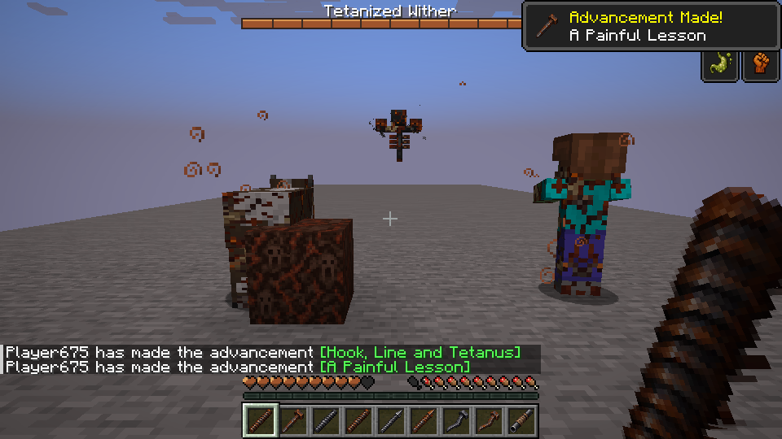

<p align="center"></p>

# Rust & Ruin

Rusting weapons, infected creatures, and a Wither worth preparing for. A Minecraft **1.20.1 Fabric** mod, version **0.1.0-beta**.

[Download on Modrinth](https://modrinth.com/mod/rust-ruin)



## Install

Put `rust-and-ruin-0.1.0-beta.jar` in the `mods` folder on **both the client and server**. Requires **Java 17**, **Fabric Loader 0.16.14+**, and **Fabric API for 1.20.1**. Replace older copies.

**JEI is optional.** Crafting and cooking recipes appear normally; the custom Rusting category shows all 11 supported item conversions. Tested with Fabric JEI 15.3.0.4. No other mod dependencies are required.

## Weapons and rust

Craft nails, rebar, sharpened rebar, metal pipes, and caltrops. Nails deal one heart per throw and are consumed when they hit a creature. Rebar deals half a heart on a fully charged hit against an unarmored target. Armor, critical hits, enchantments, and cooldowns still apply.

Dropped metal items rust after **5 consecutive seconds submerged in water** or **15 seconds exposed to rain**. Iron swords, axes, pickaxes, shovels, and hoes have matching rusted variants. Rusting preserves durability, enchantments, names, and stack counts. Items in inventories do not rust.

Rusted industrial weapons inflict Tetanus on successful hits. Rusted iron tools have a **20% infection chance**. Tetanized arrows work with bows and crossbows; **Infinity still consumes them**. Their infection sound plays at the impact. Rusty caltrops play the sound at the trap.

Hold a **Wire Brush** in either hand and a rusty item in the other, then use the brush. Cleaning costs one durability per item and returns **one Rust per cleaning action**. Rust has no active use; save it for Tetanized Soul Sand. A grindstone also removes rust, with its normal enchantment removal rules.

| Craft | Ingredients |
| --- | --- |
| 4 Nails | 2 iron ingots and flint |
| Rebar | 2 iron ingots and a chain |
| Sharpened Rebar | Rebar, flint, and an amethyst shard |
| Bent Nail | Nail and andesite |
| Metal Pipe | 2 iron ingots and a copper ingot |
| Caltrops | 4 nails and string |
| Wire Brush | 3 iron nuggets, copper ingot, and a stick |
| Tetanus Antitoxin | Honey bottle, golden carrot, fermented spider eye, and glass bottle |
| Tetanized Arrow | Arrow, rusted nail, and rotten flesh |
| Tetanized Soul Sand | Rust, soul sand, and 1 iron ingot; shapeless |

Use the recipe book or JEI for the shaped layouts. Recipes unlock when you acquire iron.

## Tetanus and infected food

Tetanus lasts **120–300 seconds** per hit. Symptoms develop in stages: stiffness and slowness, involuntary spasms, then stronger movement and nervous-system disturbances. Infected players have rusty brown hearts. Ordinary infected mobs take small, periodic, nonlethal damage. Antitoxin cures ordinary Tetanus; milk also clears normal status effects.

Successful rusty projectile hits have a **5% chance** to permanently tetanize zombies, creepers, skeletons, endermen, or villagers, and a **2% chance** for animals. A failed mutation roll can still cause ordinary Tetanus. Permanent creatures use a rusted skin overlay and keep their mutation across saves.

Hostile variants gain 50% maximum health and a melee damage bonus where supported; creepers have a larger explosion. They retain normal loot and drop an additional **1–3 iron nuggets and one Rust**. Animals move slower and drop **only 1–3 Infected Meat**, replacing their ordinary item drops. Permanent mutations cannot be cured with ordinary medicine.

Raw Infected Meat causes Tetanus and has a **10% chance of Salmonella**. Salmonella lasts 60 seconds, with vomiting every 10 seconds after the first 10 seconds. Each episode removes two hunger points and deals half a health point of nonlethal damage. Cook infected meat in a furnace, smoker, or campfire to make it safe.

## Fishing salvage

A dropped fishing rod breaks after **5 consecutive seconds touching water**, returning **2 sticks and 2 string**, with a **15% chance** of a Rusty Fishing Hook. Finding the hook earns **Hook, Line and Tetanus**. Rain alone does not break rods.

## Tetanized Wither

Build the usual Wither shape using **four Tetanized Soul Sand blocks** and three Wither Skeleton Skulls. This ritual has a **5% chance** to create a Tetanized Wither; otherwise it summons a normal Wither. Ordinary soul sand never rolls for the variant.

The variant has **600 health**, a rusted appearance, and a custom boss bar. It drops its Nether Star, a **Tetanus I** enchanted book, 5–10 experience bottles, and one randomized reward: 2–5 diamonds, 1–2 netherite scraps, 2 golden apples, or 4–8 emeralds. Defeating it earns **Tetanus. Nice One!**

Apply the book at an anvil to melee weapons and tools. Successful direct melee hits then inflict Tetanus. The enchantment is not available from enchanting tables or villager trades.

## Commands and sound events

Operator permission level 2 is required:

```mcfunction
/rustandruin summon minecraft:zombie ~ ~ ~
/rustandruin summon minecraft:cow ~ ~ ~
/rustandruin summon minecraft:wither ~ ~ ~
/rustandruin tetanize @e[type=minecraft:zombie,distance=..10]
```

Summoning a variant through the command bypasses the random chance. Only mobs can be summoned. Existing mob AI and models are preserved; skins are overlays, so wool, clothing, or armor may cover parts of them.

All custom sound events are available to `/playsound`:

```mcfunction
/playsound tetanusmod:tetanus_effect master @a ~ ~ ~ 1 1
/playsound tetanusmod:spasm master @a ~ ~ ~ 1 1
/playsound tetanusmod:vomit master @a ~ ~ ~ 1 1
```

## Configuration

Launch once to create `config/tetanusmod.json`. Stop the instance before editing it. Settings include infection duration, rust timing, damage, sound volume, camera shaking, and mutation probabilities. Default probabilities are `mobConversionChance: 0.05`, `animalConversionChance: 0.02`, `witherConversionChance: 0.05`, and `salmonellaChance: 0.10`.

Older default conversion rates migrate to the new balance once; other customized probabilities are retained. Internal IDs remain `tetanusmod` for existing saves.

## Build and test

With JDK 17 installed:

```powershell
.\tools\Build.ps1 -Test
# Or:
.\gradlew.bat build runGameTest --console plain
```

On Linux/macOS, use `./gradlew build runGameTest`. The JAR is written to `build/libs/`. GameTests and the client smoke test are separate development mods and are excluded from the release JAR. See [VALIDATION.md](VALIDATION.md) for results and client test setup.

`tools/Generate-Resources.ps1` rebuilds data and imports retained artwork. Source atlases and their prompts are in [assets-source/art](assets-source/art); the supplied logo and audio are retained. Generated artwork is identified in the source notes.
