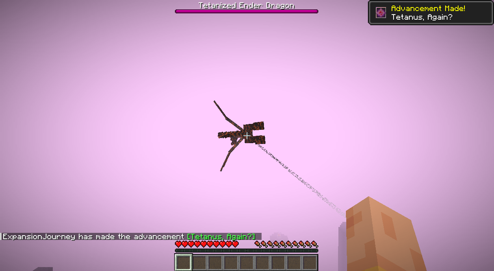

<p align="center"></p>

# Rust & Ruin

Throw nails, set rusty traps, and fight infected creatures. Rust & Ruin adds weathering weapons, three diseases, village medics, and Tetanized Wither and Ender Dragon fights with their own rewards.

**Minecraft 1.20.1 Fabric · version 0.1.2-beta**

[Download on Modrinth](https://modrinth.com/mod/rust-ruin) · [Recipes](docs/RECIPES.md) · [Advancements](docs/ADVANCEMENTS.md) · [Validation](VALIDATION.md) · [0.1.1-beta test gallery](validation/release-ready-2026-11-14/index.html) · [Expansion notes](docs/RELEASE_NOTES_2026-11-14.md) · [Requested features](docs/REQUEST_AUDIT.md) · [Security review](docs/SECURITY_AUDIT.md) · [File audit](docs/FULL_AUDIT.md)

[](validation/expansion-2026-11-14/index.html)

The pictured playtest shows the Tetanized Ender Dragon. The [0.1.1-beta release record](docs/RELEASE_READINESS_0.1.1-beta.md) and [test gallery](validation/release-ready-2026-11-14/index.html) contain that version's results and screenshots.

## Install

Put `rust-and-ruin-0.1.2-beta.jar` in `mods` on **both client and server**, replacing older copies. Requires **Java 17, Fabric Loader 0.16.14+, and Fabric API for 1.20.1**.

JEI and REI are optional alternatives. Both display crafting, cooking, disease brewing, nine rusting conversions, batch arrow smithing, prescription writing, and crystal forging. Install your chosen viewer with its own dependencies; Rust & Ruin itself only requires Fabric API.

## Weapons and rust

Nails deal one heart per throw; rebar deals half a heart on a fully charged unarmored hit. Metal pipes, sharpened rebar, hooklines, and a new **Iron Spear** offer other options. The spear has seven base damage, a slower attack than an iron sword, and a right-click thrust reaching 4.5 blocks. Solid walls block the thrust.

Dropped supported metal rusts after **five consecutive seconds touching water** or **fifteen seconds in exposed rain**. Conversion preserves item names, damage, enchantments, and stack counts. Brush it clean to collect Rust, or place Rust on floors and walls. Existing rusty iron tools retain their IDs and behavior, but are retired from new rusting and the Creative tab in favor of the spear.

Caltrops and barbed wire damage creatures that step through them. **Bear Traps** close after one activation, holding the victim in place with Slowness X; use a **Trap Reset Tool** to release it, with three seconds to move clear before rearming. Rusty traps spread Tetanus. Traps play infection sounds at their position.

**Tetanus TNT** uses one TNT at the center of a 3×3 crafting grid, four Rust in the corners, and four gunpowder on the sides. Its explosion has twice the power of regular TNT, plays **Tetanus. Nice One!**, and leaves a cosmetic rust cloud for 5–15 seconds.

The **Rust Magnet** pulls loose nails, Rust, and metal salvage from within seven blocks. Each successful pulse costs durability.

Fishing rods left in water break into two sticks and two string, with a 15% Rusty Fishing Hook chance. Craft a hookline from the hook, chain, string, and a stick to pull and infect creatures up to twelve blocks away.

## Diseases and protection

| Disease | Symptoms | Treatment |
| --- | --- | --- |
| Tetanus | Random 5–10 minutes; stiffness, spasms, rusty HUD and tab-list hearts | Tetanus Antitoxin; milk cannot cure it |
| Lockjaw Sonata | Blocks eating during the final random 2–4 minutes of ordinary Tetanus; standalone potion lasts one minute | Tetanus Antitoxin; milk cannot cure it |
| Salmonella | Vomiting, nausea, hunger loss, and light nonlethal damage | Natural recovery or ordinary milk treatment |
| Rabies | Permanent; loses one heart of maximum health per minute down to two hearts, then ten seconds of nausea per minute; purple-red hearts | Rabies Cure from a medic, or death; milk and Tetanus Antitoxin do not cure it |

The Tetanus Vaccine grants twenty minutes of 80% prevention. Gloves halve rusty-contact risk and have 192 durability. Equip them by right-clicking or using their **dedicated inventory slot** above the offhand slot. Combined vaccine/glove protection is 90% by default. Gloves appear on your character, support Unbreaking and Mending, and repair from XP while equipped. They do not protect against contaminated food or potions.

**Tetanus Protection** is shield-only: a held enchanted shield adds 65% prevention against Tetanus I or 40% against II. Blocking the attack still prevents its normal damage. **Rabies Vaccine** provides twenty minutes of 90% prevention and is craftable or sold by medics. Vaccines prevent new infections; they do not cure existing ones. Milk clears beneficial vaccine effects.

Craft the reusable **Field Guide** from a book, Rust, and a feather. Its ten scrollable chapters include the connected server's prevention settings.

## Creatures and village medics

Permanent tetanized hostiles gain 50% maximum health and extra attack damage where supported. Animals move slower. Skins retain each creature's original texture layout. Only **permanently tetanized animal variants** replace their ordinary drops with 1–3 Infected Meat; temporary Tetanus does not change animal loot. Equipped items and stored cargo still follow vanilla drop rules. Hostiles keep normal drops and add Rust plus a modest randomized salvage reward.

| Difficulty | Natural or world-generation Tetanized chance | Spawner chance |
| --- | --- | --- |
| Peaceful | 0% | 0% |
| Easy | 0.5% | 3% |
| Normal | 1% | 5% |
| Hard | 2% | 8% |

Withers and the Ender Dragon are excluded from these automatic rolls. Rusty contact retains the configurable default mutation chances of 2% for animals and 1% for other ordinary mobs. Certain unconverted mammals and undead can instead become rabid, at 0.3%/0.6%/1% on Easy/Normal/Hard. Rabid creatures have thirty extra health points, seven extra armor points, custom skins, and five-point melee attacks before armor. Only rabid animals drop Rabid Meat. Raw Infected Meat causes Salmonella only; raw Rabid Meat causes Rabies and immediate nausea unless vaccination prevents infection. Both meats become safe when cooked.

Medics progress from **Nurse** through **Nurse Practitioner**, **Medical Doctor**, and **Attending Physician**. Each rank adds one randomized treatment and one supply or barter offer. Village medics stock clinic and brewing supplies. Field medics can buy Rust and sell cave equipment. Treatment trades require emeralds and a **Medical Prescription**. Write one with paper and an ink sac at a **Prescription Writer**, the only survival source. Craft the writer, find it in a new clinic or cave camp, or buy the table from a medic who stocks it. Village medicine offers have 2–4 purchases per delivery. Native gossip and Hero of the Village discounts apply.

New village locations roll a **55% clinic chance**, with suitable terrain and a free plot required. Five biome themes use local materials, medical uniforms and supply chests. A crafted **stainless-steel Medicine Cabinet** also gives an unemployed villager the profession without a clinic. Field medics in cave tents have at most two purchases per offer and replenish at most once per 72,000 world ticks. Other villagers offer selected weapons, traps, tools and hooks. Species-colored variant eggs have their own **Rust & Ruins Spawn Eggs** tab.

## Brewing and enchanted arrows

Bottle cow manure and brew it with water for a five-second Nausea potion. Add Rust for Tetanus, Infected Meat for Salmonella, or Rabid Meat for Rabies. Brew Tetanus with a pufferfish for Lockjaw Sonata. Gunpowder and dragon's breath make splash and lingering variants. [Exact recipes](docs/RECIPES.md).

Tetanized Arrows now use a **smithing table**: empty template, ordinary arrows as base, one Rust as addition. One Rust coats up to 64 arrows. They cause one minute of Tetanus alone and consume ammunition even with Infinity. **Tetanus I/II** books work on swords, axes, spears, industrial melee weapons, bows, crossbows, and tridents. Nails, hooklines, and mining tools cannot accept them. Enchanted shots cause full-duration infection; combining them with infected arrows adds 25% duration. Tetanus II keeps its stronger symptoms for the infection duration: it disorients targets, makes mobs wander and sometimes miss attacks, and deals two points of nonlethal damage every ten seconds.

## Wither, dragon, and beacon progression

Use Rust on an iron golem for an 18% conversion chance; rusty projectile hits also have a dedicated 18% conversion chance by default. The rusty guardian has 200 maximum health. Each Survival Rust attempt consumes one Rust.

Four Tetanized Soul Sand blocks in the ordinary Wither ritual give a **75%** Tetanized Wither chance. A netherite block replacing the upper center soul sand adds 25 percentage points, making the default chance **100%**. A failed roll still summons an ordinary Wither and consumes the ritual.

The special Wither has **650 health**, a custom boss bar and appearance, extra loot, native **50 XP**, and one Tetanized Wither Star. It drops exactly **one** enchanted book: a 50% chance of Tetanus II, otherwise Tetanus I. Its first wave of up to two **20-health** Tetanized Wither Skeletons appears 10-15 seconds after its spawn shield ends, while a player is nearby. Later waves follow every random 30-60 seconds, with at most six living minions per Wither. Nearby Creative observers can see the waves too. Minions carry iron swords and can inflict Wither and Tetanus. Vaccination reduces infection risk without making this fight immune to Tetanus. Wire-brush the special star for an ordinary Nether Star, or keep it for the beacon and forging progression.

The beacon requires a pyramid made **only of Rusted Iron Blocks** and netherite ingot payments. Its steel-panel menu separates effect selection from explicit **II / III / IV** controls and shows the required payments. Level II is the starting strength; a full pyramid offers Regeneration II or a level III primary upgrade. A full pyramid can instead select **level IV** by paying a Tetanized Wither Star **in addition to** the netherite ingot. Each confirmed IV selection consumes a new star. An active beam automatically grants Tetanus Resistance. Placement and full-strength activation have separate mod advancements and do not award vanilla beacon advancements.

Craft a **Tetanus Wither Forging Table** from four netherite blocks, an Eye of Ender, two blaze powder, a Tetanized Wither Star, and an anvil. At the table, combine **one End Crystal + one Rust + one netherite ingot** into one **Tetanized End Crystal**. Use four of these crystals in the ordinary exit-portal respawn positions to guarantee the special dragon. Mixing special and normal crystals respawns an ordinary dragon. During a special ritual, all ten pillar-top healing crystals also become tetanized. Their explosions can infect creatures that actually take blast damage; cover, distance, and Creative immunity still apply.

The **Tetanized Ender Dragon** has **1,100 health**, a rust-and-purple boss bar, and attacks that spread Tetanus. It can grab a nearby Survival player in its mouth, lift them ten blocks, and drop them. A close pass has a **15% grab chance**, with a **120-second cooldown** after a successful grab. Its native dragon XP sequence remains unchanged. With mob loot enabled, every special victory drops one shared **Tetanized Dragon Egg** and **Tetanus Overload Sword** on solid ground outside the exit fountain. The rewards glow and do not despawn. The egg keeps the vanilla black silhouette with small rust chips, and the victory plays a slower, reverberant cue nearby.

The sword has **12 attack damage**, **2.3 attack speed**, **4,062 durability**, and Tetanus II already applied. It accepts compatible sword enchantments. Repair it with **netherite blocks at an anvil** or Mending; netherite ingots do not repair it.

Summoning the special dragon awards **Tetanus, Again?** to nonspectating players within 256 horizontal blocks of the central End portal. Dealing at least 20 actual health damage during its fight qualifies a player for **The End of Tetanus?** when it dies.

Both Tetanized bosses deal double damage on boss-owned attacks. The Wither marks orange rings before Rustquake or a three-skull barrage. The dragon marks purple rings before a Rustfire breath pool or a Wingstorm knockback. At half health, both enrage and cast their special attacks more often.

## Advancements, commands, and sounds

The Rust & Ruin advancement tree has four branches. Drag or scroll to move through it; hold Shift to scroll sideways, and press Home to return to the start. Vanilla advancement tabs still unlock through their normal gameplay requirements. Existing advancement progress is preserved.

The [advancement guide](docs/ADVANCEMENTS.md) gives the exact actions for each milestone, including medic cases, disease prevention, and the dragon damage requirement.

Operator permission level 2:

```mcfunction
/rustandruin summon minecraft:spider ~ ~ ~
/rustandruin summon minecraft:wither ~ ~ ~
/rustandruin tetanize @e[type=minecraft:zombie,distance=..10]
/give @s tetanusmod:iron_spear
/give @s tetanusmod:rabid_cow_spawn_egg
/playsound tetanusmod:tetanus_effect master @a ~ ~ ~ 1 1
/playsound tetanusmod:spasm master @a ~ ~ ~ 1 1
/playsound tetanusmod:vomit master @a ~ ~ ~ 1 1
```

The canonical save namespace remains `tetanusmod`; `/give` also suggests matching mod item paths without needing the namespace typed first.

## Configure, build, and test

Launch once to create `config/tetanusmod.json`. Stop the instance before editing it. Existing settings control rust timing, disease duration, damage, sound volume, camera shaking, rusty-contact mutation chances, and Tetanus vaccine/glove protection. Automatic mutation rates can be configured separately by difficulty and source; the tables above show the defaults. Rabies retains the nonlethal two-heart floor. Custom duration settings remain intact; older default durations migrate to 300–600 seconds.

With JDK 17:

```powershell
.\gradlew.bat build runGameTest
.\gradlew.bat runClientSmoke
.\gradlew.bat -PwithJei runClientSmoke
.\gradlew.bat -PwithRei runClientSmoke
.\tools\Audit-Files.ps1 -Report .tools/file-audit.json
.\tools\Audit-Release.ps1
```

Use `--offline` if dependencies are already cached. The distributable is `build/libs/rust-and-ruin-0.1.2-beta.jar`. See [validation](VALIDATION.md) for the repository's test procedures.

Wild tetanized and rabid variants use their species' normal despawn and mob-cap rules. Previously affected saves are repaired on load while recognizable player-kept creatures retain persistence. See the [October 19 source and despawn audit](docs/DESPAWN_AUDIT.md).

## Animal care, supplies, and exploration

A single-use **Veterinary Kit** cures a permanently tetanized or rabid animal, restoring its normal movement, attributes, appearance, behavior, and drops. Treating one earns **Clean Bill of Health**. Craft a kit from two leather, a golden apple, two antitoxins, Rabies Cure, and string.

Use **honeycomb** with clean, rustable equipment in your other hand to wax it. Coating costs one honeycomb per item and protects dropped equipment for ten minutes of water/rain exposure by default. Each point of equipment durability use also consumes one second of coating. The coating survives saving and item splitting. It does not clean already rusty items or protect traps after placement. JEI and REI have dedicated coating displays.

Use a **Clinic Notice Board** in new clinics and cave camps to preview and choose a two-stage case. You can craft a board or sneak and right-click a medic for the rotating case. Complete both objectives with the appropriate medic to earn supplies, emeralds, a reputation discount, and **Special Delivery**. Progress survives reloads and respawns. Use `/mediccase` to see your objective or `/mediccase abandon` to drop the case.

A **Field Splint** reduces spasms for 90 seconds during Tetanus. Antitoxin treats the underlying infection.

**Abandoned workshops** can generate in new chunks in plains, sunflower plains, forest, birch forest, taiga, meadow, savanna, and dark forest biomes. Their ruined forges contain rusty traps, modest salvage, worn weapons, and occasional medicine. They add no creature spawners.

Natural mutation settings now separate animals, other mobs, and dungeon spawners for each difficulty. Current defaults are 0.5%/1%/2% natural and 3%/5%/8% spawners; matching old defaults migrate automatically, while other customized rates are retained. Configure `naturalAnimalEasy/Normal/Hard`, `naturalMobEasy/Normal/Hard`, and `spawnerEasy/Normal/Hard` in `config/tetanusmod.json` and restart the server. `coatingWeatherTicks` defaults to 12000.

Operators can use `/rustandruin inspect <entity>` to inspect mutation and despawn state, or `/rustandruin population [1-128]` to count nearby loaded mobs. These commands do not load additional chunks. See the [fresh numbered audit](docs/LINE_AUDIT.md) for review coverage, fixes, and limits.

## Medic cave camps and armed monsters

Infection announcements are positional and limited to nearby listeners (16 blocks). Existing infections, natural mutations, chunk loading and inherited mutations stay quiet. Medics have their own short vial-and-supplies work sound, audible within 12 blocks.

Medic tents can appear in roomy, dry Overworld caves, using a 15% roll for each suitable cave site within a widely spaced candidate chunk. Natural floor support, an open interior and an entrance are required; this is not a 15% chance per cave or chunk. Camps remain over 2,000 blocks apart. Each has a fenced, lit courtyard, two beds, a field medic, a support farmer with an irrigated crop patch, a supply chest and a persistent 200-health Tetanized Iron Golem. The wider cave search retains old successful placements before checking additional sites. Clinics and camps generate in new terrain; existing villages are not retrofitted.

Operators can use `/locate structure rustandruin:medic_clinic`, `/locate structure rustandruin:medic_tent`, or `/locate structure #rustandruin:medics`. Shortcuts: `/rustandruin locate medic` and `/rustandruin locate tent`. Branded clinic and tent commands also give the exact entrance, including Y. For a clinic, follow the entrance coordinates rather than the native village start-chunk marker. `/locate poi rustandruin:medic_tent` searches only 128 blocks; it is for nearby workstations. Older command IDs continue to work. Disease commands use the same namespace: `/effect give @s tetanusmod:rabies infinite`; short names such as `/effect give @s rabies` also work. These operator commands bypass vaccine prevention.

Skeletons can trade their bow for rusty nails; zombies can carry rebar, a rusty pipe, or a rusty spear. Weapon chances are 2%/4%/6% on Easy/Normal/Hard. Nail skeletons respect line of sight, and their missed shots cannot be collected for free ammunition. Rusty player-thrown nails now have a 0.7-second cooldown.

The [November 14 release notes](docs/RELEASE_NOTES_2026-11-14.md) describe the gameplay patch. The final candidate passed **423/423 native tests** and **all 16 visible-client reports**; [release readiness](docs/RELEASE_READINESS_0.1.1-beta.md) records the exact artifact, coverage, and limits. The [camp and proximity-audio fixes](docs/CAMP_AUDIO_FIXES_2026-10-25.md) and [24-request refresh](docs/REFRESH_2026-10-23.md) retain their earlier results and limits.

The earlier [full-project audit](docs/REAUDIT_2026-10-23.md) records stability fixes, including pack-animal cargo preservation, End-return disease persistence, glove synchronization, trap contact checks, and native Wither ritual compatibility.
